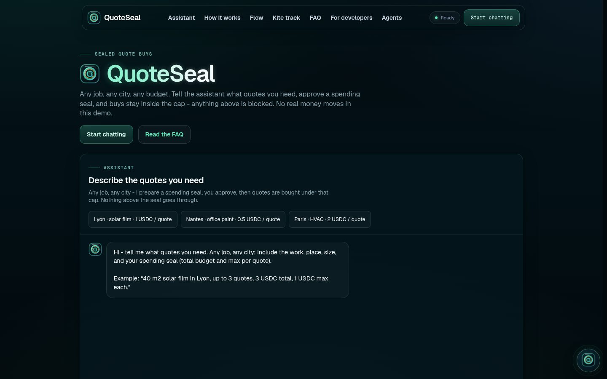
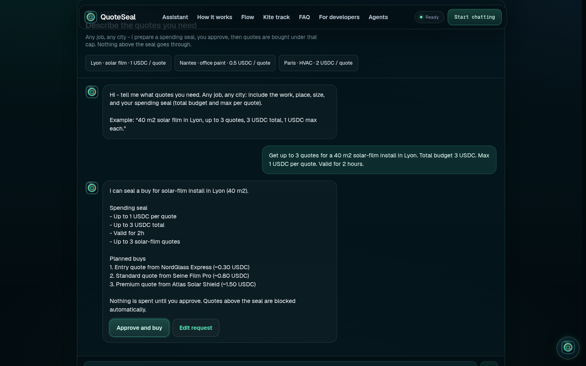
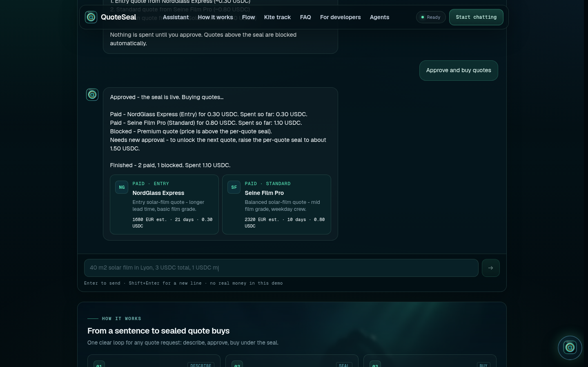
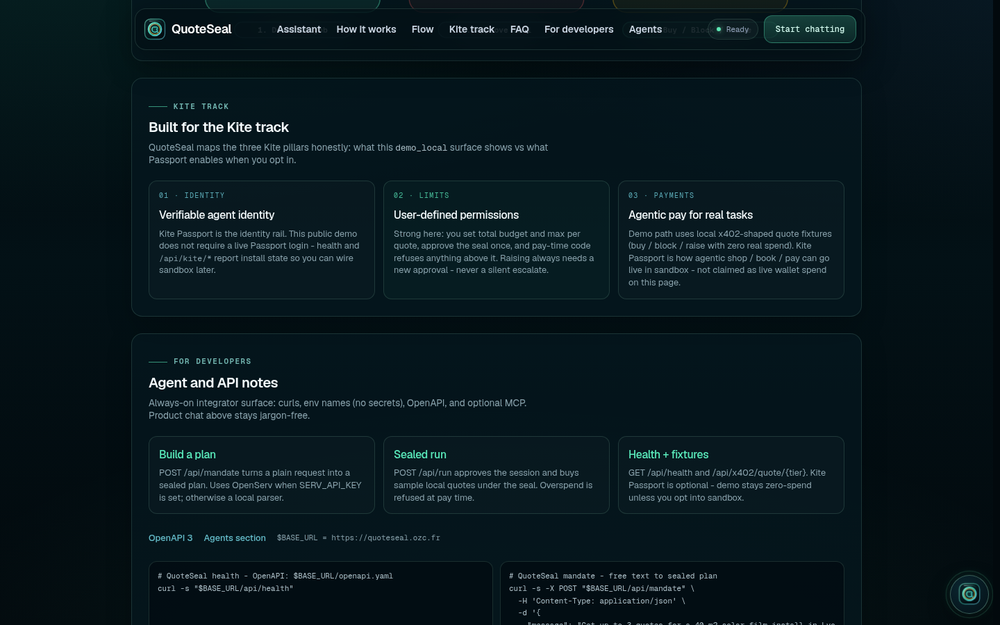
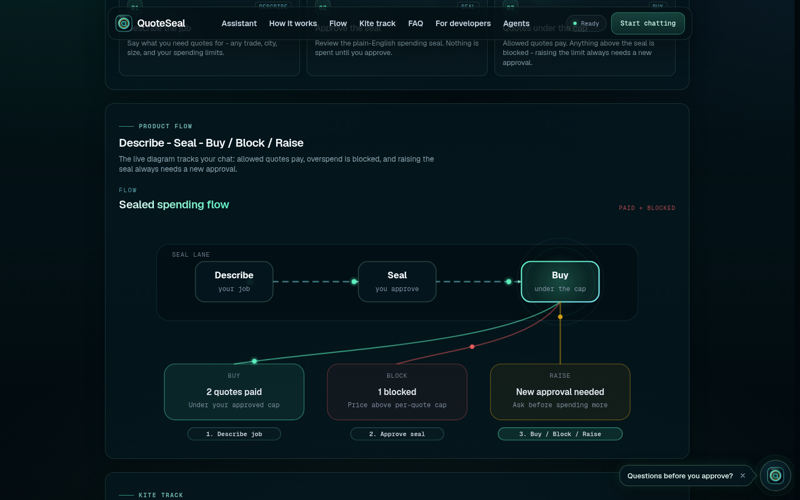
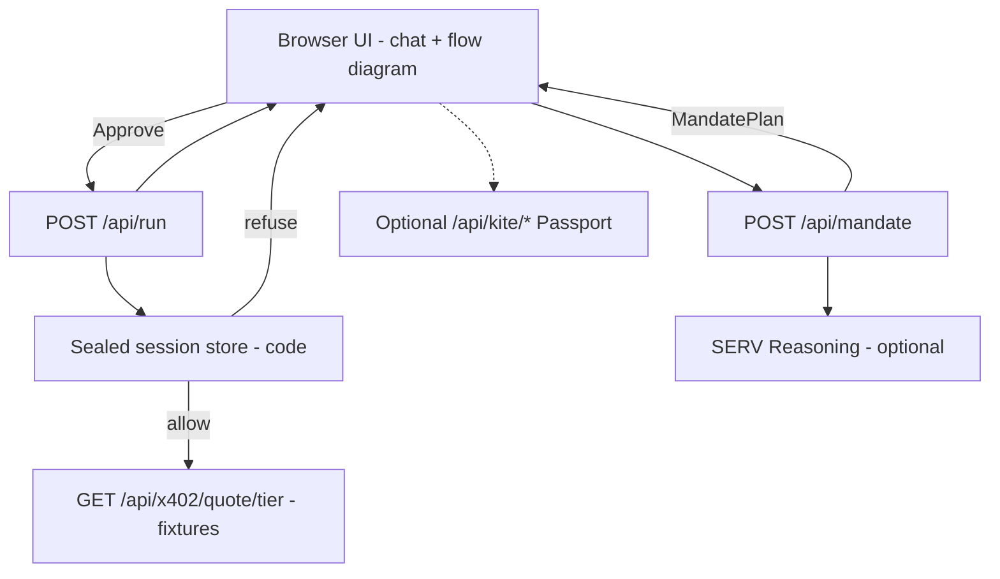
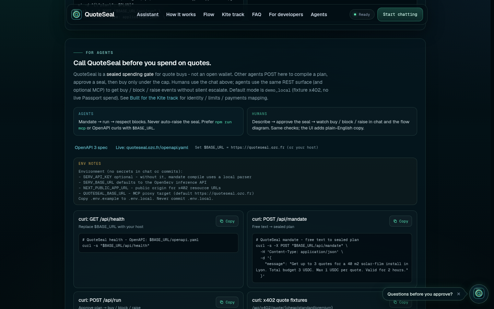

# QuoteSeal

**Sealed agent spending for quotes** - SERV Hackathon Edition 02, **Kite** track.

Agents that can pay need hard caps. QuoteSeal turns a plain-English request into a **spending seal** (total + max per quote). You approve once. Quotes inside the cap are paid; anything above is **blocked** at pay time. Raising the limit always needs a **new approval** - never a silent escalate.

| | |
| --- | --- |
| Live | https://quoteseal.ozc.fr |
| Repo | https://github.com/ThibautMilville/QuoteSeal |
| OpenAPI | https://quoteseal.ozc.fr/openapi.yaml |
| License | MIT |







## Built for the Kite track (honest map)

Three Kite pillars - what this demo shows, and what it does **not** claim:

| Pillar | What QuoteSeal shows | Caveat |
| --- | --- | --- |
| Verifiable identity | Optional `/api/kite/status` + `/api/kite/session`; Passport is the identity rail | Default path is `demo_local` - **no live Passport login required** |
| User-defined permissions / spending limits | Spending **seal**: total + max per quote, pay-time refuse, raise needs new approval | Strongest pillar in this demo |
| Agentic payments (shop / book / pay) | Local x402-shaped quote fixtures - buy / block / raise under the seal | **Zero real spend** on the public demo; Passport sandbox is opt-in |

UI section: `#kite` on the live site.



## Where SERV sits (rules = code, judgment = SERV)

| Step | Who | Role |
| --- | --- | --- |
| Mandate compile | **SERV** (or local parser) | Free text → typed `MandatePlan` (caps, plan steps, rationale) |
| Seal approval | **Human** | Nothing spends until Approve |
| Session create | **Code** | `demo_local` session with the approved caps |
| Pay-time check | **Code** (authoritative) | Per-quote + total caps; overspend → `quote_blocked` |
| Raise copy | **SERV** (optional) | Phrasing for a higher cap ask - never unlocks payment alone |
| Safety | **Code** | SERV cannot override a block or silently raise the seal |

Without `SERV_API_KEY`, mandate compile and raise phrasing use deterministic fallbacks with the same shape (app stays usable). Rules stay in code; judgment helps plan and explain.

## How it works

| Step | What you see | What runs |
| --- | --- | --- |
| **Describe** | Chat + scenario chips | `POST /api/mandate` → sealed plan |
| **Seal** | Plain-English caps + Approve | Session proposal (per-tx + total + TTL) |
| **Buy** | Paid quote cards | Local merchants under the seal |
| **Block** | Clear refusal copy | Pay-time rule check refuses overspend |
| **Raise** | New approval ask | Optional SERV phrasing for a higher cap |

The on-page **Product flow** diagram animates Describe - Seal - Buy and the three outcomes (Buy / Block / Raise). It tracks the live chat when you run a demo.



## Architecture



ASCII map:

```
Browser (Next.js UI)
  ├─ Opening intro (Three.js seal)
  ├─ Mandate chat + Product flow diagram
  └─ Kite / developers / agents sections
        │
        ▼
  API routes
  |- POST /api/mandate          - SERV or local parser → MandatePlan
  |- POST /api/run              - sealed session + buy / block / raise events
  |- GET  /api/x402/quote/[tier] - fixture merchants (cheap / standard / premium)
  |- GET  /api/health
  +- /api/kite/*                - optional Passport status / session
```

**Stack:** Next.js 15, TypeScript, Tailwind 4, Three.js intro, Zod, OpenAI-compatible SERV client, optional `kpass` CLI, MCP tools.

Folder map: `src/components/*` (UI), `src/shared/mandate` + `run` + `quotes` (seal + fixtures), `src/shared/serv`, `src/shared/kite`, `src/app/api/*`, `mcp/server.ts`, `public/openapi.yaml`.

## Demo scenarios (jury walkthrough)

Open https://quoteseal.ozc.fr (or http://localhost:3010), skip or watch the intro, then use a chip or type the exact prompt.

### Lyon - block premium (default)

**Chip:** `Lyon · solar film · 1 USDC / quote`

**Exact prompt:**

```text
Get up to 3 quotes for a 40 m2 solar-film install in Lyon. Total budget 3 USDC. Max 1 USDC per quote. Valid for 2 hours.
```

1. Read the spending seal (3 USDC total, 1 USDC max per quote) - **limits** pillar.
2. Click **Approve and buy**.
3. Expect: cheap (~0.3) + standard (~0.8) **paid**; premium (~1.5) **blocked**; **raise ask** for a higher per-quote seal - no silent escalate.

### Paris - HVAC all pay

**Chip:** `Paris · HVAC · 2 USDC / quote`

**Exact prompt:**

```text
Get 3 HVAC install quotes for 120 m2 in Paris. Session budget 5 USDC. Max 2 USDC per quote. Valid for 2 hours.
```

Expect: cheap + standard + **premium can all pay** under the wider per-quote cap.

### Nantes - tight cap (optional)

**Chip:** `Nantes · office paint · 0.5 USDC / quote` - more blocks (standard/premium often refused).

Fixture merchants (USDC test):

| Path | Vendor | Price |
| --- | --- | --- |
| `/api/x402/quote/cheap` | NordGlass Express | 0.3 |
| `/api/x402/quote/standard` | Seine Film Pro | 0.8 |
| `/api/x402/quote/premium` | Atlas Solar Shield | 1.5 |

## API

| Method | Path | Purpose |
| --- | --- | --- |
| `GET` | `/api/health` | Readiness + optional Kite / SERV hints |
| `POST` | `/api/mandate` | Body `{ message }` → sealed `MandatePlan` |
| `POST` | `/api/run` | Body `{ plan }` → session + buy/block/raise events |
| `GET` | `/api/x402/quote/cheap` | Fixture merchant |
| `GET` | `/api/x402/quote/standard` | Fixture merchant |
| `GET` | `/api/x402/quote/premium` | Fixture merchant |
| `GET` | `/api/kite/status` | Passport / `kpass` install state |
| `POST` | `/api/kite/session` | Optional real Passport session when logged in |

```bash
BASE_URL=https://quoteseal.ozc.fr

curl -s "$BASE_URL/api/health"

curl -s -X POST "$BASE_URL/api/mandate" \
  -H 'Content-Type: application/json' \
  -d '{"message":"40 m2 solar film in Lyon, 3 USDC total, 1 USDC max per quote"}'
```

`POST /api/run` expects the `MandatePlan` returned by `/api/mandate` (or a `{ plan }` wrapper). Events include `session_approved`, `quote_paid`, `quote_blocked`, `raise_ask`, `done`. Mode on the default path: `demo_local`.

## For agents (MCP / OpenAPI)

| | |
| --- | --- |
| OpenAPI 3 | [`/openapi.yaml`](./public/openapi.yaml) (live: https://quoteseal.ozc.fr/openapi.yaml) |
| UI | Sections `#developers` and `#agents` |
| MCP | `npm run mcp` - tools `quote_seal_mandate`, `quote_seal_run`, `quote_seal_health` |

```bash
npm run mcp   # QUOTESEAL_BASE_URL defaults to https://quoteseal.ozc.fr
```

**Agent rule:** when an event is `quote_blocked` / `raise_ask`, do not force the payment. Show the human a new seal approval.



## Local setup

```bash
git clone https://github.com/ThibautMilville/QuoteSeal.git
cd QuoteSeal
cp .env.example .env.local
npm install
npm run dev
```

Open **http://localhost:3010**

Useful scripts:

```bash
npm run typecheck
npm run build
npm run lint
npm run mcp
```

### Environment (`.env.example`)

Copy to `.env.local`. **Never commit `.env.local`.** No real secrets belong in the repo.

| Variable | Required | Notes |
| --- | --- | --- |
| `SERV_API_KEY` | No | Without it, mandate compile uses a local parser. Get a key at https://console.openserv.ai. Server-only - never `NEXT_PUBLIC_`. |
| `SERV_BASE_URL` | No | Defaults to OpenServ inference API |
| `SERV_MODEL_FAST` / `SMALL` / `LARGE` | No | Model routing tiers |
| `NEXT_PUBLIC_APP_URL` | No | Public origin for x402 resource URLs (default `http://localhost:3010`) |
| `QUOTESEAL_BASE_URL` | No | MCP HTTP target (default `https://quoteseal.ozc.fr`) |
| `KPASS_BIN` | No | Absolute path to `kpass` if not on `PATH` |

Optional Kite Passport CLI:

```bash
curl -fsSL https://cli.gokite.ai/install.sh | bash
```

Health and kite routes report install / login state. The demo remains zero real spend until you explicitly use a sandbox Passport session.

## Safety

- **No custody** and **no real USDC** on the default `demo_local` path.
- Overspend is refused at pay time in application code.
- Raising the seal requires a new user approval - never a silent escalate.
- SERV proposes plans and copy; it cannot unlock a payment the seal blocks.
- Public demo API has no auth today - treat the base URL as a demo surface.
- Not financial advice. Fixture vendors and prices are for demonstration only.

## Hackathon context

- **Event:** SERV Hackathon 02
- **Track:** Kite (agent payments / Passport-shaped spending)
- **Story:** sealed quote purchases with hard caps, local merchants, optional Passport wiring
- **Non-goals:** custody, production payments, Amazon checkout, silent budget increases

## License

See `LICENSE` in this repository.
